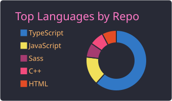
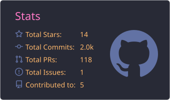

### Hi there!👋 

My name is **`ESTEBAN MANRUPE`**, a reskilled **electronic engineer** now working as a **`Senior FrontEnd Developer`** at **Modernize**.

I'm currently part of the **UI Specialty Team** on a **large-scale project** with six cross-functional teams, building and implementing the **design system** and the **common components** used across the whole project, and resolving UI tickets along the way. I work with **React**, **TypeScript**, **Redux Toolkit**, and **Material UI**, focusing strongly on **responsiveness**, **accessibility**, and **code quality**. At work my IDE is **Kiro**, the evolution of the **Amazon Q** extension I used in VS Code. On my own projects I use **Claude** and **Cursor**. I leverage **AI-powered tools** to move faster on migrations and repetitive work, and I review everything before it ships.
  

🧰 My <b>PORTFOLIO</b>: https://portfolio-esteban-manrupe.vercel.app/
  
📱 My latest project: <b>¿Cómo vamos?</b>
  

A free score-keeping app for card and dice games popular in Argentina — **Truco, Generala, Tute, Burako, Carioca** and more. Built with **React Native** (Expo), no ads, no sign-up, fully offline. Live on **Google Play** and the **App Store**.

👉 https://peurman.github.io/comovamos/
  

Previously, I worked as a **`FrontEnd React Developer`** at **The Tapping Solution**, where I led the frontend of a **brand-new web application** that complements the company’s mobile app, built with **React**, **TypeScript**, **Tailwind CSS**, and **Material UI**. I integrated **Stripe**, **RevenueCat**, **Algolia**, **Amplitude** and **Braze**, implemented **unit tests with Jest**, and collaborated with designers and backend engineers.
  

Before that, I worked as a **`FrontEnd UI Developer`** at **Adopt IQ**, through the consultancy **Digital Executive**, where I translated UI/UX designs into a responsive **React** project, ensured accessibility compliance, and built scalable interfaces using **Tailwind CSS**. I collaborated closely with designers and full-stack developers, maintained cross-browser compatibility, and followed modern front-end best practices.
  

Then, I was a **`Software Engineer`** at **Aconcagua Software**, working mainly with **React** and **Vue**.
  

In parallel, I also collaborated as a **`Freelance React Developer`** at **Voxologic**, in a project involving **React**, **Redux**, **AWS**, **Socket.IO**, among other tools.
  

Earlier in my career, I worked as an **`Angular FrontEnd Developer`** at **Applaudo**, using **TypeScript** and **Angular**, supported by tools such as **Confluence**, **Jira**, **Bitbucket**, and **GitLab**.
  

As you can see in the repositories pinned below, I built projects with **React** and **Angular**.
  
I also added the **2003 Final Project** to graduate as an **Electronic Engineer**, built with **C++** and **Visual C**.
  

🛠️ Languages and Tools:

* *Front:* 

* *Back:* 

* *Tools:* 

⚡ My stats:
  

  
  

📫 Contact me:
 

  
  
  
 
<!-- 

 -->

<!--    -->
  
  

<!--
**peurman/peurman** is a ✨ _special_ ✨ repository because its `README.md` (this file) appears on your GitHub profile.
Here are some ideas to get you started:
- 🔭 I’m currently working on ...
- 🌱 I’m currently learning ...
- 👯 I’m looking to collaborate on ...
- 🤔 I’m looking for help with ...
- 💬 Ask me about ...
- 📫 How to reach me: ...
- 😄 Pronouns: ...
- ⚡ Fun fact: ...
-->
